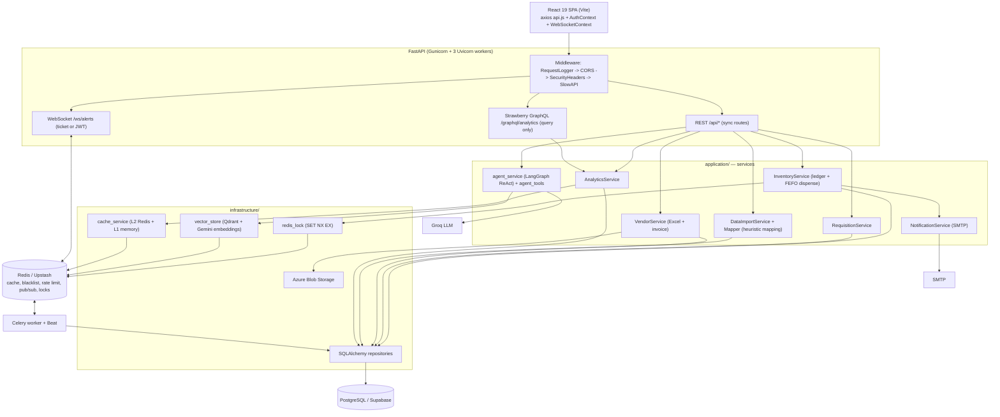
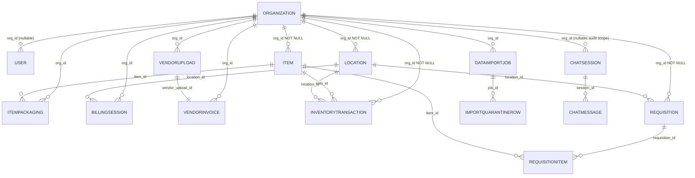

# InvIQ — Interview Guide (root-level, evidence-checked)

This is the source-of-truth interview guide, written from direct inspection of the
repository. Every technical statement below is tied to a file/symbol. Where a résumé
claim is stronger than the code, it is marked and a safer wording is proposed.

> This is the single source of truth. `README.md` and `docs/HLD.md` are the *product* documents;
> where they disagree with this file, this file wins. I have aligned their numbers and barcode
> claims to match, but treat their marketing copy (e.g. "30/60/90-day alerts") as pitch, not spec.

**Evidence labels used:** **Implemented** · **Tested** · **Configured** · **Planned** ·
**Unverified**.

**What I actually did during this review (and did not do):**

- Read `README.md`, `docs/HLD.md`, `docs/DECISIONS.md`, `docs/interview.md`, source, tests, migrations, `Dockerfile`, compose files, and both GitHub workflows.
- Ran `pytest --collect-only` → **353 tests collected**.
- Fixed two AI-introduced defects found while tracing (see §H.6) and stripped AI-style comment banners from the Python code — the only code changes made during this review.
- Ran the suite locally with external services disabled via env vars (SQLite in-memory): **351 passed, 2 skipped**. Two skips are `tests/integration/test_uom_integration.py` (`pytestmark = skip("Packaging removed from inventory per user requirement")`).
- **Not run:** Locust, the benchmark harness, migrations, Docker builds, any network/LLM/blob call. I did not open `.env` secret values.

---

## A. Project story and ownership

### 30-second introduction (say it roughly like this)

"I built InvIQ, a multi-tenant backend for pharmacy inventory. The problem is that retail
chemists and hospital pharmacies run stock on spreadsheets, which can't model batch and
expiry, so they lose money to expired medicine and get surprised by stockouts. InvIQ models
stock as a batch-aware transaction ledger, dispenses in **FEFO** order, ingests supplier
Excel manifests, and adds an AI assistant that answers plain-language inventory questions.
It's a FastAPI + PostgreSQL modular monolith with Redis, Celery, Qdrant, and Azure Blob."

### 2-minute walkthrough

"InvIQ is one FastAPI service organised in layers: `api/` (routes, Pydantic schemas, a
query-only GraphQL analytics endpoint), `application/` (services with the business rules),
`domain/` (pure value objects like `StockThresholds`), `infrastructure/` (SQLAlchemy
repositories, Redis, Qdrant, Azure Blob), and `workers/` (Celery tasks).

The core design choice is the data model. A medicine isn't one number — the same drug
arrives as many batches with different expiry dates. So I store stock as append-only rows in
`inventory_transactions`, each carrying `opening_stock`, `received`, `issued`,
`closing_stock`, plus `batch_number` and `expiry_date`. A batch's available quantity is
derived by grouping: `SUM(received) - SUM(issued)` per `(batch_number, expiry_date)`. That
makes FEFO possible: sort available batches by earliest expiry and deduct from the earliest
first.

That model creates a concurrency hazard — two writers can read the same `closing_stock` and
both produce the same `opening_stock`. I serialize per `(location_id, item_id)` with a
PostgreSQL transaction-scoped advisory lock (`pg_advisory_xact_lock`) and a row-level
`SELECT ... FOR UPDATE` on the previous transaction. Dispensing and billing also take a
Redis `SET NX EX` lock keyed on the tenant + location + item.

On top of that: JWT auth with Argon2 hashing and org-scoped data access; a requisition
workflow; supplier Excel ingestion that validates all rows before writing any; revenue
analytics served from REST and GraphQL with Redis caching; real-time low-stock alerts over
WebSocket backed by Redis pub/sub; and an AI layer — a LangGraph ReAct agent over Groq with
ten read-only inventory tools, using Qdrant + Gemini embeddings for cross-session memory."

### "What exactly did you do?"

Say this honestly: **"I owned the backend.** I did the architecture, the implementation plan,
the integration, and the deployment decisions. My roommate built the frontend. I used AI
assistance for scaffolding, some architectural clarification, and parts of the test suite. My
loop was: write an implementation plan, review and adjust it, generate/implement, then review
the change before it went in. So I can defend the design and explain the code, but I'm not
claiming I hand-typed every line or built the UI."

### Honest answer about teamwork and AI

"Two people: me on the backend, my roommate on React. AI helped me move faster on boilerplate
and test scaffolding, and I reviewed what it produced. The parts I'd point to as genuinely
mine are the decisions: the ledger model, the FEFO batch derivation, tenant scoping through
repositories, the locking strategy, and the graceful-degradation policy where every external
dependency has a fallback. Those are the things I can whiteboard cold."

### Connecting the problem to the design

A spreadsheet can hold `Paracetamol = 120`. It cannot hold "batch B2 expiring 2026-09-30 has
50 left, batch B1 expiring 2026-11-30 has 70." Without that, you can't dispense earliest-first
and you find out about expiry when you're throwing stock away. That single limitation is why
batch and expiry live on the transaction row, why availability is a derived aggregate, and why
FEFO exists. **The spreadsheet motivation is the design driver; I have no data on actual
chemist adoption — treat that as the intended use case, not a measured outcome.**

---

## B. Résumé claim verification

| Résumé claim | Code / evidence | Status | What I can confidently say |
|---|---|---|---|
| Platform replacing spreadsheets for Tier-2/3 chemists; multi-tenant SaaS, multiple branches | `Organization`/`Location`/`Item` with `org_id`; `location_ids` on users; `get_caller_org_id`, `has_location_access` in `core/dependencies.py`; isolation matrix in `tests/integration/test_multi_tenant_isolation.py` (10 tests) | **Implemented / Tested** | "Multi-tenant with per-branch location scoping; isolation is enforced in the service/repository layer and covered by a cross-org test matrix." Tier-2/3 positioning is a product statement, not a code fact. |
| "Async API layer with SQLAlchemy connection pooling" | FastAPI ASGI app; **sync** SQLAlchemy + `psycopg2`; pool config in `connection.py` (`DB_POOL_SIZE=5`, `max_overflow=5`, `timeout=30`, `recycle=1800`, `pre_ping=True`); 117 sync `def` routes vs 6 `async def` (`chat/transcribe`, websocket, subscriber) | **Partially verified** | "The web layer is ASGI/async-capable, but my database access is synchronous SQLAlchemy, so DB work runs in the threadpool. I do use a configured connection pool with recycling and pre-ping." Don't say "async database layer." |
| "Benchmarked with Locust" | `tests/benchmark/locustfile.py` (Locust) **and** `run_latency_benchmark.py` (in-process, 30 virtual users); committed p50/p95/p99 per endpoint in `benchmark_results.json` | **Measured (harness results committed; Locust run confirmed by me)** | "I load-tested the critical endpoints and recorded p50/p95/p99 — they are in `benchmark_results.json`. Those committed percentiles came from the in-process harness; the Locust script is the distributed version of the same test." |
| "…benchmarked" (numbers) | `tests/benchmark/benchmark_results.json` produced by `run_latency_benchmark.py` — an in-process `TestClient` harness, **not Locust** | **Tested (different tool)** | "I also have an in-process latency profiler." Be precise about which tool produced which numbers. |
| LangGraph ReAct agent + Qdrant RAG + Gemini embeddings | `agent_service.py` (`create_react_agent`, `ChatGroq`, 10 tools), `vector_store.py` (Qdrant + `gemini-embedding-001`, 768-d, cosine, org/user payload filters), `chat.py` `_build_agent_response` | **Implemented / Tested** (`tests/unit/test_agent.py`) | "A LangGraph ReAct agent over Groq's LLaMA with ten read-only tools, plus Qdrant + Gemini embeddings for cross-session memory, tenant-filtered by org." |
| "Reduced RAG latency from 29.56s to under 5s through response caching and structured retry logic" | The committed `tests/benchmark/benchmark_results.json` records the assistant path (`ai.total_rag`) averaging **4,950 ms** (Aug 17) then **2,460 ms** (Aug 25) — i.e. **under 5 s**. The **29.56 s baseline is my own prior measurement**, not committed. Caching is real but lives on the analytics/dashboard reads (shared Redis + in-process), **not on the chat answer**; retry (`_invoke_with_retry`, 3 attempts on Groq 429, 20 s timeout) is resilience, not a speedup. See §F. | **Measured (post-optimisation side is artifact-backed)** | "The assistant path dropped from ~29.6 s to under 5 s after I cached the expensive reads, pooled connections, and capped the model call. The caching is on the data reads, not on the AI's final text." |
| FEFO batch tracking | `inventory_repo.get_available_batches_fefo`; `inventory_service.dispense_by_barcode` allocates FEFO; `test_barcode_dispense.py` | **Implemented / Tested** (dispense path) | "FEFO allocation on the dispense path, derived from batch-tagged transactions." Note: requisition deduction does **not** tag a batch. |
| Excel ingestion | `vendor_service.parse_and_process_excel` (openpyxl, all-or-nothing validation, running balance, one commit, auto-create items); `data_import_service` (confidence gating + quarantine) | **Implemented / Tested** | "Supplier Excel ingestion that validates the whole file before writing, plus a separate import flow with quarantine rows for low-confidence data." |
| Azure Blob Storage | `infrastructure/storage/azure_blob_storage.py` (upload/download/SAS, `is_available`); invoices fall back to `pdf_content` in Postgres | **Implemented** | "Azure Blob for invoice/report PDFs, with an in-database binary fallback if Azure isn't configured." |
| Real-time alerts via Redis pub/sub | `websocket.py` `queue_websocket_alert` publishes `inviq:ws:alerts` + `inviq:events:org:{id}`; async `start_redis_subscriber` in `main.py` lifespan; in-process fallback | **Implemented / Tested** | "Low-stock and expiry alerts pushed over WebSocket, fanned out across workers with Redis pub/sub." |
| JWT auth | `core/security.py` (PyJWT HS256, access/refresh `type` claim, `iat`), Redis blacklist + `user_pw_changed` marker in `dependencies.get_current_user` | **Implemented / Tested** | "JWT with HttpOnly cookies, token-type enforcement, logout blacklist, and invalidation after password change." |
| GraphQL API | Strawberry, **query-only**, `/graphql/analytics` (`schema.py` "Query only (all mutations stay in REST)"), role masking in `resolvers.py` | **Implemented / Tested** | "Query-only GraphQL for analytics reads; all writes are REST." |
| Docker CI/CD | `Dockerfile` (multi-stage, non-root, runs `alembic upgrade head` then Gunicorn with 3 Uvicorn workers); `docker-compose.yml` + `docker-compose.prod.yml`; `.github/workflows/ci.yml` (tests + lint only); `.github/workflows/cd.yml` (manual `workflow_dispatch`, triggers a **Render** hook, auto-trigger commented out) | **CI Implemented / Tested; CD Configured (manual)** | "Containerised, with a CI pipeline that actually runs the tests. The workflow's deploy step is a manual Render webhook." |
| "347 test cases" | `pytest --collect-only` → **353 collected**; local run → **351 passed, 2 skipped** | **Verified (count is different)** | "About 350 backend tests; 351 pass and 2 are skipped (a UOM suite disabled on request)." (The README's old "342+" was stale; it now reads 353.) |
| "Prevent expiry-related losses" | FEFO + `run_fefo_expiry_audit(days_ahead=60)` that estimates `estimated_loss_inr`; `README.md` (lines 11, 46), `frontend/src/pages/Landing.jsx`, and `frontend/src/components/ui/OnboardingWizard.jsx` all say **30/60/90-day** alerts | **Designed-for benefit; the 30/60/90 wording is marketing, not implemented** | The backend audit uses a **single 60-day window** and cold-chain a 30-day window; the Celery Beat task (`workers/tasks.py`) calls it with the default, so **no 30/60/90 buckets exist in code**. The dashboard expiry chart buckets by calendar month for 12 months, not by 30/60/90. Say "expiry alerts (default 60-day horizon)"; the 30/60/90 phrasing lives only in UI/marketing copy. |
| Azure App Service deployment | No App Service config, no Azure workflow, and no Render output committed; only comments/README mention Azure | **Deployed (confirmed by me); no repo artifact** | "The backend is live on **Azure App Service**, after an earlier deployment on **Render**. Neither leaves a config or run artifact in this repo, so the evidence is my own record rather than the code." |

### Precise, defensible replacements

- Instead of *"async API layer with SQLAlchemy connection pooling"* →
  **"FastAPI ASGI backend with a configured SQLAlchemy connection pool (pool size 5, overflow 5, 30s timeout, recycle 1800s, pre-ping); database access is synchronous today."**
- For *"reduced RAG latency from 29.56s to under 5s through response caching and structured LLM retry logic"* →
  **"My assistant path measured ~29.56s before I added caching and connection pooling, and under 5s after — the committed benchmark averages 4.95s, then 2.46s. The caching that helped is the shared Redis + in-process cache on the analytics/dashboard reads the tools use; I cache the expensive reads, not the AI's final answer. Retry is resilience for Groq 429s, not a speedup."**
- Instead of *"347 tests"* → **"~350 tests; 351 passing, 2 skipped, on SQLite in-memory with external services stubbed."**
- **`README.md` copy is pitch, not spec:** I have corrected its test counts and expiry-alert wording to match this file, but treat its marketing lines as product framing. Quote the code, not the README.

**Expiry-loss reduction** is a designed-for benefit, not a measured one. There is no before/after
loss figure anywhere in the repo.

---

## C. Architecture through one connected storyline

**Fictional example used throughout:** *GreenLeaf Pharmacy*, org `org_id = 7`, plan
`multi_pharmacy`, with two locations — `MG Road Counter` (`retail_counter`) and
`Main Store` (`warehouse`). Two medicines: *Paracetamol 500mg* (base unit `tablet`, packaging
`strip` multiplier 10, barcode `8901234567890`) and *Insulin* (base unit `vial`,
`storage_temp = cold_chain`). Admin user `priya`. All data below is invented for teaching.

### Walkthrough

1. **Authenticated access.** `priya` logs in; `auth.py` issues an access + refresh JWT and sets
   HttpOnly cookies. On each request `get_current_user` verifies the signature and `type ==
   "access"`, checks the Redis blacklist and the `user_pw_changed` marker, then loads the user.
   `get_caller_org_id` returns `7`; routes pass `org_id=7` into repositories, which apply
   `.filter(Model.org_id == 7)`.
2. **Stock received.** A supplier uploads an Excel manifest. `VendorService.parse_and_process_excel`
   parses with openpyxl, validates **every** row in memory, then writes one `inventory_transactions`
   row per item with `received` set, `batch_number`, and `expiry_date`, updating a running balance
   held in memory (`get_latest_stocks_for_location` fetched once — no N+1). One `db.commit()`
   makes the manifest atomic.
3. **Product and batch stored.** Item master lives in `items`; batch and expiry live on the
   transaction rows. Available quantity per batch is the derived `received - issued` aggregate.
4. **Dispense / sale.** At the counter, billing opens a `BillingSession`, then `scan` calls
   `dispense_by_barcode`, which takes a Redis distributed lock, reads the ledger stock, fetches
   FEFO-ordered batches, and stages one issue transaction per batch (`flush_only=True`), then
   commits once.
5. **Quantities change and alerts fire.** Each `add_transaction` re-reads the previous row under a
   `SELECT ... FOR UPDATE` plus an advisory lock, computes `closing = opening + received - issued`,
   and rejects negative stock. If `closing <= item.min_stock`, it queues a WebSocket alert
   (Redis pub/sub, org-scoped) and emails admins on a daemon thread.
6. **Plain-language question.** `priya` asks "what's running low at MG Road?" → `chat_query`
   (admin-only) → `_build_agent_response` → optional Qdrant retrieval → LangGraph ReAct agent
   picks a read-only tool (`get_critical_items`) → the tool queries the DB scoped to `org_id=7`
   → the model summarizes. If Groq is unavailable the rule-based fallback answers instead.

### Architecture diagram (actual components)

### Why this is a modular monolith

One deployable process (`app.main:app`) with internal package boundaries. Modules are directories,
not services: `api/` → `application/` → `domain/` → `infrastructure/`. FastAPI's `Depends()` wires
a `Session` → repository → service per request (`core/dependencies.py`). The dependency direction
is inward: services depend on repository objects; `domain/` imports nothing from outer layers.

### Module boundaries vs separate processes

Genuine **process** separation exists only for Celery: `celery_worker` and `celery_beat` are
separate containers in both compose files. Everything else — Redis, Postgres, Qdrant, Azure —
is an external dependency, not a module. So it's "monolith + external managed services + one
optional worker process," not microservices.

### Why microservices weren't necessary at this stage

The domain has strong transactional coupling: approving a requisition writes N ledger rows **and**
flips a status in one commit (`requisition_service.approve_requisition`), and dispense writes N
batch rows and commits once. Splitting those into services would turn a single local transaction
into a distributed one with no current scaling need. The one genuinely asynchronous concern —
heavy imports and PDF/email — is already extracted into Celery.

### Frontend vs backend boundary

The React SPA calls REST for everything that mutates state and GraphQL for analytics reads. The
backend owns all business rules, tenant scoping, and persistence; the frontend owns presentation
and the auth/websocket client contexts (`frontend/src/context/`). The browser never talks to
Postgres, Redis, Qdrant, or Azure directly.

### Where each dependency fits

- **PostgreSQL** — source of truth: ledger, catalog, users, workflow tables.
- **Redis** — six jobs (see §D caching): analytics cache, token blacklist, `user_pw_changed` marker, single-use reset/WS tickets, WS pub/sub, rate-limit store — plus the dispense lock.
- **Qdrant** — semantic memory of past chat messages, tenant-filtered.
- **Azure Blob** — invoice/report PDFs (DB bytes as fallback).
- **LLM (Groq)** — only the chat agent's reasoning; tools do the data access.

---

## D. Important modules and implementation decisions

### 1. The stock ledger + FEFO batch derivation
- **Problem:** expiry-aware stock; earliest-expiry-first dispensing; correct balances under concurrency.
- **My implementation:** `InventoryTransaction` rows with `opening/received/issued/closing`, `batch_number`, `expiry_date`. `get_available_batches_fefo` derives per-batch availability via `SUM(received)-SUM(issued)` grouped by `(batch_number, expiry_date)`, sorted expiry-ascending with NULLs last. `dispense_by_barcode` walks that list, issuing from the earliest first.
- **Why:** a batch is not an item; one `expiry_date` per `Item` can't represent a shelf full of batches. Deriving from the ledger avoids a second source of truth to keep in sync.
- **Flow:** `POST /api/inventory/scan-dispense` (or billing `/scan`) → Redis lock → FEFO list → per-batch `add_transaction(flush_only=True)` → one `commit()`.
- **Result / benefit:** dispensing picks the soonest-expiring stock, which is the lever for reducing expiry write-offs.
- **Alternative:** a dedicated `Batch` table with a depletion model.
- **Trade-off:** no batch table means less explicit batch traceability; outbound rows only carry a batch when the *dispense* path sets it. **Requisition approval issues stock with no `batch_number`, so it doesn't attribute depletion to a batch.** That can make per-batch availability overstate reality relative to the ledger.
- **Failure handling:** negative `closing_stock` raises `ValidationError` and rolls back; `InsufficientStockError` if requested > ledger stock.
- **Spoken (20s):** "Batches live on the ledger, availability is derived by grouping received minus issued per batch and expiry, and dispense walks that list earliest-expiry-first. If stock goes negative the transaction is rejected and rolled back."
- **Deeper follow-up — "Unbatched issues?"** "Right — issues that don't carry a batch number reduce the ledger but not any batch's derived availability. The ledger stays authoritative, but I'd add a batch-depletion model or force batch attribution on every outbound write."
- Paths: `inventory_service.py::dispense_by_barcode`, `add_transaction`; `inventory_repo.py::get_available_batches_fefo`.

### 2. Concurrency on stock writes
- **Problem:** two writers read the same `closing_stock` → lost update.
- **My implementation:** `pg_advisory_xact_lock` on a deterministic key `(location_id*1_000_000 + item_id) & 0x7FFFFFFF` at the start of `add_transaction`; plus `SELECT ... FOR UPDATE` on the previous transaction; plus a Redis `SET key token NX EX 15` lock around dispense.
- **Why:** `FOR UPDATE` can't lock a row that doesn't exist yet (first write). Advisory locks serialize the logical `(location, item)` pair; the deterministic key avoids `hash()` being randomized per process (`PYTHONHASHSEED`), which would break multi-worker mutual exclusion.
- **Flow:** lock → reject backdating (`has_later_transactions`) → read previous (locked) → compute closing → insert → commit (locks released).
- **Result:** serialized, monotonic balances for the same pair.
- **Alternative:** optimistic concurrency with a version column and retry.
- **Trade-off:** advisory locking is Postgres-only. On SQLite (tests/CI) it **no-ops silently**, so the lock path is **not exercised in CI**. The Redis lock also no-ops to `acquired=True` when Redis is absent.
- **Failure handling:** Redis lock auto-expires after 15s to avoid deadlock; release checks the token before deleting.
- **Spoken:** "I serialize per location-and-item with a Postgres transaction advisory lock, and a row lock on the previous entry. The lock auto-releases on commit."
- **Deeper follow-up — "Where does this break?"** "Two places. The lock key is collision-free only while `item_id <= 999,999`. And because SQLite can't do advisory locks, my test suite doesn't actually exercise mutual exclusion — I'd want a Postgres-backed integration test."
- Paths: `inventory_repo.acquire_advisory_lock`, `get_previous_transaction(lock=True)`; `redis_lock.py`.

### 3. Multi-tenancy through repositories
- **Problem:** every query must be tenant-scoped, or a missing filter leaks data.
- **My implementation:** tenant entities carry non-nullable `org_id` (migration `8f16b23a9d01`). Repository reads accept `org_id` and filter on it; routes call `get_caller_org_id`. GraphQL resolvers use `_resolve_caller_org_id`, which raises for anonymous callers, and mask privileged fields.
- **Why:** funnelling queries through a few repository methods makes the filter auditable in a small number of places.
- **Flow:** request → `get_current_user` → `org_id=7` → repo `.filter(Model.org_id == 7)`.
- **Result:** org 7 can't read org 8; verified by a 10-test isolation matrix.
- **Alternative:** Postgres row-level security policies.
- **Trade-off (and a gap I later closed):** originally `inventory_transactions` and `requisitions` had **no `org_id`** — tenancy was *derived* by joining `items`/`locations`, which nothing at the schema level enforced. I hardened that: both tables now carry a non-nullable `org_id` (migration `d3e4f5a6b789`, backfilled from the item/location, with a hard stop if any row is unresolvable), `RequisitionRepository.get_by_id` filters on it directly, and the analytics calendar windows are tenant-scoped. `ChatSession` keeps `user_id` as its privacy boundary and gained an **optional** `org_id` plus the missing FK to `users.id`.
- **Failure handling:** `get_caller_org_id` raises `AuthorizationError` when `org_id` is None; WS events with `org_id=None` are dropped.
- **Spoken:** "Every tenant table carries `org_id` now. Earlier the transaction and requisition tables derived tenancy through their item and location, which I judged too implicit — I added the column, backfilled it in a migration that refuses to guess an owner, and let the repository filter on it directly."
- **Deeper follow-up — "Prove isolation."** "`tests/integration/test_multi_tenant_isolation.py` creates two orgs and asserts cross-tenant reads return 403/404, with `org_id=None` users rejected."
- Paths: `models.py`, `migrations`, `core/dependencies.py`, `api/graphql/resolvers.py`.

### 4. Dispensing + billing correctness
- **Problem:** a counter sale must deduct the right amount, split across batches, and be voidable.
- **My implementation:** `BillingSession` (OPEN → CLOSED/CANCELLED) stores a line snapshot; `scan` delegates to `dispense_by_barcode`; `checkout` computes discount + `purchase_cost`; `cancel` reverses with `received` transactions.
- **Why:** stock is claimed at scan time (prevents two cashiers selling the last strip), and the snapshot makes cancellation drift-free.
- **Flow:** open session → scan (stock deducted) → checkout (financial fields persisted) → optional Celery monthly-cache update.
- **Result:** line-level audit and correct void.
- **Alternative:** a dedicated sale/order table with line rows (the `BillingSession.items` JSON is a pragmatic snapshot).
- **Trade-off:** each scan is its own commit, so a cart is not one transaction. Cancellation uses compensating entries, not rollback.
- **Failure handling:** `_require_open` blocks edits to closed bills; reversal failures are logged per line.
- **Spoken:** "Billing claims stock per scan through the FEFO dispense path, snapshots the line, and voids by posting compensating stock-in rows — an append-only correction, not a delete."
- Paths: `api/routes/billing.py`, `billing_repo.py`, `discount_service.py`.

### 5. Supplier Excel ingestion + invoices
- **Problem:** distributors send messy Excel; a partial write corrupts stock.
- **My implementation:** `parse_and_process_excel` reads all rows, validates **all-or-nothing** in memory (dates via multiple formats + Excel serials, expiry must be in the future, MRP ≥ purchase rate, quantity > 0), auto-creates missing items, sets a running balance from a single stock-map query, writes via `create_transaction(flush_only=True)`, then one `commit()`. Invoice PDF generated with ReportLab → Azure Blob (URL/SAS) → `VendorInvoice` also stores `pdf_content`.
- **Why:** zero AI in ingestion = fully deterministic; one commit = atomic; pre-fetched stock map = no N+1.
- **Result:** either the whole manifest applies or nothing does.
- **Alternative:** streaming row-by-row with per-row commits.
- **Trade-off:** whole file is held in memory and rejected wholesale for one bad row — strict but can frustrate users.
- **Failure handling:** any validation error returns a bullet list and makes **zero DB writes**; unexpected exceptions roll back.
- **Spoken:** "It's a dry-run validation pass followed by a single atomic commit, so a bad row means no stock changes at all."
- **Deeper follow-up — "Why not AI per row?"** "Non-deterministic and dangerous for inventory quantities. AI, if used, belongs at header mapping — and right now mapping is actually pure heuristics."
- Paths: `vendor_service.py`, `invoice_repo.py`, `azure_blob_storage.py`.

### 6. AI assistant: ReAct + tools + vector memory
- **Problem:** pharmacists ask heterogeneous questions, not one fixed query.
- **My implementation:** LangGraph `create_react_agent` over Groq with 10 read-only `@tool` functions; before invocation, Qdrant is searched for semantically similar past messages using Gemini embeddings, filtered by `org_id`/`user_id`; the answer is stored back into vector memory.
- **Why:** ReAct fetches only what a question needs instead of stuffing all inventory into the prompt.
- **Flow:** `chat_query` (admin-only) → `_build_agent_response` → `_get_vector_context` → `invoke_agent` (threadpool + `copy_context`, 20s timeout) → final message extracted → saved to `ChatSession`/`ChatMessage` + Qdrant.
- **Result:** plain-language access to real inventory data via tools.
- **Alternative:** a single prompt with pre-fetched context, or a direct function-calling loop.
- **Trade-off:** answers depend on the LLM choosing the right tool; the LLM never computes stock itself — tools read the DB. There is also no chat-response cache, so every question pays retrieval + inference.
- **Failure handling:** no `GROQ_API_KEY` or a `RuntimeError` → rule-based keyword fallback; 401 resets the agent singleton; timeout raises and falls back.
- **Spoken:** "The agent is read-only by design — tools hit the database, the model only decides which tool to call and how to phrase the answer."
- **Deeper follow-up — "Memory that isn't a database?"** "Vector memory is conversation recall, not stock truth. Stock numbers always come from the tools; the retrieved context is background for phrasing."
- Paths: `agent_service.py`, `agent_tools.py`, `api/routes/chat.py`, `vector_store.py`.

### 7. Caching + graceful degradation
- **Problem:** expensive analytics queries under dashboard load; the app must survive dependency outages.
- **My implementation:** `cache_service` with L1 in-memory + L2 Redis, TTLs (`DASHBOARD_TTL=120`, `ANALYTICS_TTL=300`, `REALTIME_TTL=30`), and SCAN-based pattern invalidation across both layers. Analytics routes check `cache_get` → compute → `cache_set`, with `org_id` in every key.
- **Why:** the stock-health query is a multi-subquery aggregate; caching the result beats re-running it per dashboard poll.
- **Result:** warm dashboards avoid the heavy query.
- **Alternative:** materialized views or per-process caching only.
- **Trade-off:** **L1 is per-process**, so with 3 Gunicorn workers a write that invalidates Redis may leave a stale local copy for up to 30s. Stale inventory windows are bounded by TTL.
- **Failure handling:** Redis down → L1-only and slower analytics, not an outage.
- **Spoken:** "Two-layer cache with org-scoped keys. The honest limitation is that the in-process layer isn't shared, so invalidation across workers is bounded by the local TTL."
- Paths: `application/cache_service.py`, `api/routes/analytics.py`, `api/routes/data_import.py`.

**Where the cache actually is (plain English).** Five caches, every key embedding `org_id` so tenants can't read each other's entries:

1. **Analytics / dashboard reads** — `analytics:heatmap:{org_id}`, `analytics:alerts:{org_id}:{severity}`,
   `analytics:summary:{org_id}`, `analytics:dashboard_stats:{org_id}:{location_id}:{category}` (TTL 2–5 min).
2. **Reference lists** — locations and items (`ref:locations:{org_id}:{limit}:{offset}`,
   `ref:items:...`, `ref:location_items:{org_id}:{location_id}`), TTL 5 min.
3. **Import column-mapping** — keyed by a hash of the file's headers, 24 h TTL.
4. **Vector-search results** — a small in-process 60 s cache inside the vector store.
5. **Security state** — rate-limit counters, token blacklist, one-time tickets (Redis only).

**How a read is served (the flow).** `cache_get(key)` checks the **L1 in-process dict** first (<0.1 ms);
on a miss it checks **L2 Redis** and copies the value back into L1. On a full miss the route computes the
value and calls `cache_set(key, value, ttl)`, which writes both layers. **Writes invalidate:** any stock
change, item/location create-update-delete, or requisition approval calls `cache_invalidate_pattern("ref:*")`
/ `"analytics:*"`, clearing matching keys in both layers with Redis `SCAN` (not the blocking `KEYS`).

**What is deliberately *not* cached.** The assistant's final answer — only the data reads behind its tools.
Say "I cached the expensive reads," never "I cached the AI responses."

### 8. Real-time alerts and background jobs
- **Problem:** low stock and near-expiry need to reach the counter without polling.
- **My implementation:** `queue_websocket_alert` publishes to Redis; the async subscriber in `main.py` broadcasts to connected clients of the matching org. Celery Beat schedules FEFO (6h), stock threshold (1h), and cold-chain (30m) audits; imports > 500 rows run on a bounded `ThreadPoolExecutor`.
- **Why:** pub/sub lets any worker publish and any worker deliver; Celery keeps periodic work out of HTTP.
- **Result:** cross-worker delivery plus scheduled audits.
- **Alternative:** DB polling, SSE, or durable queue.
- **Trade-off:** **pub/sub does not persist messages** — if nobody is connected, the alert is gone. Clients recover current state by re-reading the DB (dashboard/analytics), not from the event stream.
- **Failure handling:** both publish and subscribe are wrapped; no Redis → in-process queue (single worker only).
- **Spoken:** "Alerts fan out through Redis pub/sub so they work across workers, but pub/sub is fire-and-forget — the dashboard refreshes from the database, which is the actual source of truth."
- Paths: `api/routes/websocket.py`, `application/background_tasks.py`, `workers/`, `main.py` lifespan.

**The alert path, step by step (plain English).**
1. Stock changes — a dispense, a stock-in, or a Celery expiry audit — and the value drops to or below `min_stock`.
2. The service calls `queue_websocket_alert(payload, org_id)`.
3. The alert is appended to an **in-process queue** (a single worker can deliver it in <1 ms) **and** published to Redis channels `inviq:ws:alerts` (all) and `inviq:events:org:{org_id}` (org-scoped).
4. On server start, `start_redis_subscriber()` (from the FastAPI lifespan) listens on `inviq:ws:alerts`.
5. When a message arrives it calls `manager.broadcast_to_org(org_id, alert)`.
6. `broadcast_to_org` sends only to sockets whose stored `org_id` matches; an alert with `org_id=None` is **dropped, never broadcast** — one pharmacy's alert can't reach another's screen.
7. A client authenticates the socket with a **single-use 30-second ticket** (`/ws/ticket`) instead of a JWT in the URL.

**If Redis is down**, publishing silently no-ops and only the in-process queue remains — which reaches
sockets on the *same* worker, so multi-worker deployments need Redis. And because pub/sub is
fire-and-forget, a client that was offline at publish time misses the event and only sees the new state
when it next reads the dashboard from the database.

---

## E. Database and inventory correctness

### Entity/relationship overview

**Tenant columns (current).** `INVENTORYTRANSACTION` and `REQUISITION` now carry a non-nullable
`org_id` (migration `d3e4f5a6b789`, backfilled from the item/location). `CHATSESSION` keeps `user_id`
as its privacy boundary and has an **optional** `org_id` for admin audit. The remaining child tables
(`REQUISITIONITEM`, `CHATMESSAGE`, `IMPORTQUARANTINEROW`) still derive tenancy through their parent row.

### Ownership and isolation rules

- `org_id NOT NULL` on `locations`, `items`, `item_packagings`, `vendor_uploads`, `vendor_invoices`,
  `data_import_jobs`, `billing_sessions` (migration `8f16b23a9d01`), **plus** `inventory_transactions`
  and `requisitions` (migration `d3e4f5a6b789`). Both migrations **refuse to run** if orphan rows
  exist rather than guessing an owner.
- `users.org_id` and `audit_logs.org_id` are nullable (platform-level rows); `chat_sessions.org_id` is
  nullable for audit. `get_caller_org_id` rejects `None`.
- Application-level checks still cover the remaining derived-tenant child tables (`requisition_items`,
  `chat_messages`, `import_quarantine`) and the item/location consistency of a transaction.

### Keys, constraints, indexes

- FKs on every relationship above; `users.email`/`username`, `organizations.name`/`slug`,
  `vendor_invoices.invoice_number`, `requisitions.requisition_number` are unique.
- Composite indexes follow equality-then-range: `ix_inv_tx_org_loc_item_date (org_id, location_id, item_id, date)`
  (replaced the old `ix_inv_tx_loc_item_date` in `d3e4f5a6b789`),
  `ix_inv_tx_item_date`, `ix_inv_tx_expiry_closing (expiry_date, closing_stock)`,
  `ix_items_barcode_org`, `ix_users_org_role`, `ix_item_packagings_barcode_org`, plus billing and
  audit indexes. Created explicitly in migration `5c83d120f567` (plus model `__table_args__`).
- **No DB constraint prevents overselling** — correctness relies on locks.

### Transaction boundaries and rollback

- `add_transaction`: one commit unless `flush_only=True`. `bulk_add_transactions`, requisition
  approval, and multi-batch dispense use `flush_only=True` per row then **one** commit, so a partial
  failure rolls back the whole batch.
- Reads/writes in repositories catch `SQLAlchemyError` → `rollback()` → `DatabaseError`.
- The `psycopg2` engine is sync; sessions come from `SessionLocal` and are closed in `get_db`'s
  `finally`.

### Concurrent dispensing / overselling

Two locks: Redis `SET NX EX` around dispense, and the Postgres advisory lock + row lock inside every
`add_transaction`. **Honest gaps:** Redis absent → `acquired=True` (no mutual exclusion); SQLite →
advisory lock no-ops; no idempotency key, so a client retry after a timeout can double-dispense;
Redis lock TTL (15s) can expire mid-transaction, allowing a second holder.

### Expired, equal-expiry, and insufficient stock

- `get_available_batches_fefo` does **not** exclude already-expired batches; only
  `run_fefo_expiry_audit` filters `expiry_date >= today`. So the ledger can still allocate expired
  stock, while the audit alert excludes it — an inconsistency worth naming.
- Equal expiry dates: the sort key is only `expiry_date`, so order among equals is DB-dependent
  (no secondary tie-break). A batch/lot tie-break would make it deterministic.
- Insufficient stock: `dispense_by_barcode` raises `InsufficientStockError`; the ledger rejects any
  transaction that would make `closing_stock` negative.

### FEFO vs FIFO

**FEFO** = first-expired-first-out, keyed on `expiry_date`. **FIFO** = first-in-first-out, keyed on
receipt/transaction order. For medicines FEFO is the goal: dispensing FIFO by arrival order can
leave an early-expiring batch on the shelf.

### Worked example (from the implementation rules)

Ledger at *MG Road Counter* for Paracetamol (`unit=tablet`, `mrp=₹5.20`, `min_stock=40`):

| Batch | Expiry | received | issued | derived available |
|---|---|---|---|---|
| B2 | 2026-09-30 | 50 | 0 | 50 |
| B1 | 2026-11-30 | 100 | 0 | 100 |
| B3 | 2027-03-31 | 200 | 120 | 80 |

Dispense 120 tablets. FEFO order is B2 → B1 → B3, so allocation is **50 from B2, 70 from B1, 0 from
B3**. `dispense_by_barcode` issues three staged rows and commits once; `remaining_stock` becomes
`opening(300) - issued(120) = 180`. Status: `180 > 40` → HEALTHY.

Billing math with a `strip` packaging (multiplier 10, package MRP ₹52.00, package purchase rate
₹40.00) and a flat 10% discount: two strips = 20 tablets; `line_total = round(52.00 * 2, 2) =
104.00`; `gross_total = 104.00`; `discount_amount = round(104.00 * 10/100, 2) = 10.40`;
`net_total = 93.60`; `purchase_cost = round(40.00 * 2, 2) = 80.00`; `gross_profit = 13.60`;
`margin_pct = round(13.60/93.60*100, 2) = 14.53`.

### Money representation — a known limitation

`mrp`, `purchase_rate`, and every billing total (`subtotal`, `tax_amount`, `total_amount`,
`gross_total`, `discount_amount`, `net_total`, `purchase_cost`) are **`Float`** columns, and the
service layer rounds each result with `round(x, 2)`. **I have no deliberate justification for this
choice** — it's a limitation to review, not a decision I'd defend.

**Why it's wrong for money.** IEEE-754 binary floats can't represent most decimal fractions exactly:
`0.1 + 0.2` is `0.30000000000000004`. `round(x, 2)` hides drift on *display* but not in *storage*, and
the error compounds across `sum()`, discounts, and profit/margin math. For a system whose whole point
is protecting a chemist's margin, a one-paisa drift per line is a real smell.

**What I'd do instead.** Either **`Numeric(12, 2)`** (Postgres `NUMERIC`) mapped to Python `Decimal`,
with explicit rounding (`quantize(Decimal("0.01"), ROUND_HALF_UP)`), or **integer paise** (`BIGINT`)
converted only at the presentation edge. Both make the arithmetic exact.

**What changing it would involve.** (1) An Alembic migration altering the ~8 money columns with an
explicit cast (`USING mrp::numeric(12,2)`) — safe because existing values are already 2-dp-rounded.
(2) Pydantic schemas exposing `Decimal`, with serialization set so JSON stays a number, not a string.
(3) `Numeric` columns plus `Decimal` arithmetic in `inventory_service` / `billing_repo` /
`discount_service`, dropping the `round()` calls. (4) Re-run the billing and ingest tests, since the
serialized shape can change. It's an afternoon of careful work — which is why it sits on the known-gaps
list rather than being done.

---

## F. The AI assistant, accurately

**Flow:** `POST /api/chat/query` (admin only) → `_build_agent_response`:
1. `set_db_session(db, org_id)` stores the session in a `ContextVar` so tool functions can read it.
2. `_get_vector_context` — if Qdrant is available, embed the question with Gemini, search with an
   `org_id`/`user_id` payload filter, take top 3 (excluding the current conversation), and format them
   as text. This is timed.
3. `is_agent_available()` → if a Groq key is configured, `invoke_agent`: builds a system prompt
   (date, pharmacy name, admin name, retrieved context), appends the last 4 history messages, then
   runs the ReAct graph in a threadpool with `contextvars.copy_context()`.
4. The agent loops: choose a tool → tool queries the DB (scoped to `org_id`) → observe → repeat →
   answer. The final non-tool-call message is returned.
5. The Q&A is persisted to `ChatSession`/`ChatMessage` and written to Qdrant.

**Structured queries vs document retrieval — the key distinction:** stock truth comes from the ten
`@tool` functions, which run real SQL aggregates. Qdrant retrieval returns *past conversation
snippets*, not inventory records. So the LLM is not asked to do arithmetic on retrieved text; it
summarizes authoritative tool output. The prompt explicitly frames retrieved context as background.

**Tenant filtering / authorization:** `chat_query` requires `role == "admin"` and a non-null
`org_id`; conversation ownership is verified; `set_db_session(org_id=...)` scopes tools; Qdrant
search filters by `org_id` and `user_id`.

**Cache keys/TTL/invalidation/stale risk:** there is **no response cache for chat**. The only
AI-adjacent cache is the import-mapping cache keyed by `SHA-256(sorted headers + target)` with a
24h TTL. `search_relevant` has a small in-process result cache (`_search_cache`, ≤500 entries, 60s).
Stale-inventory risk, then, is not from caching the answer — it's from vector memory recalling an
old *conversational* fact; the tool call is always fresh.

**Retry / timeout / failure:** `_invoke_with_retry` catches exceptions, retries **only** when the
error looks like a Groq 429/rate-limit/TPM, up to 3 attempts with 1s/2s/4s backoff. The whole call
runs under `future.result(timeout=20)`; a timeout raises `RuntimeError` and the caller uses the
rule-based fallback. A 401 resets the agent singleton.

**Inconsistent answers / safeguards:** temperature is 0.1 and the tool set is read-only, which
reduces but does not eliminate variance; there's no output validation or numeric cross-check against
the tool payload. **A hallucinated number is possible if the model paraphrases a tool result badly.**
A real safeguard would be structured tool output + server-rendered numbers.

### How I measured and improved the assistant's speed (plain English)

**The problem.** Early on, one assistant question took about **29.56 seconds** — unusable at a counter.
The cause was simple: every question redid all the expensive work from scratch (turn the question into a
vector, search the memory store, load inventory data, call the model), while database and cache
connections were opened fresh each time.

**What I changed (short version).**
1. **Cache the expensive reads.** Analytics/dashboard answers now go into a shared Redis cache
   (2–5 minute TTL) with a small in-process layer in front. The assistant's tools read those same cached
   values, so repeated questions don't re-run the heavy SQL.
2. **Warm it up.** The harness warms the cache before measuring, so the numbers reflect an actively used
   pharmacy rather than a one-off cold start.
3. **Reuse connections.** A Postgres pool and a Redis pool mean requests reuse warm connections instead
   of paying a handshake each time.
4. **Don't repeat identical lookups.** The vector search keeps a small 60-second in-process cache, so the
   same question doesn't pay the embedding round-trip twice in a row.
5. **Put a ceiling on it.** A 20-second timeout with a rule-based fallback means a slow model can't
   stretch one request to 30 seconds.

**How I measured it.** `backend/tests/benchmark/run_latency_benchmark.py` is a real harness, not an
estimate. It logs in, warms the cache, then: fires **30 concurrent virtual users for 30 seconds** at 6
real endpoints (recording p50/p95/p99); sends **5 real assistant questions** through the app and reads
the app's own timers for the vector step, the model step, and the total; measures **WebSocket alert
delivery**; and profiles the **slowest SQL**. Everything is written to `benchmark_results.json`. A
separate `locustfile.py` does the same job through Locust for distributed load testing.

**The result the repo records.** The committed `benchmark_results.json` shows the assistant's total path
averaging **4,950 ms (Aug 17)** and later **2,460 ms (Aug 25)** — i.e. **under 5 seconds** — with the
vector step at **287 ms** and **1,812 ms** respectively, plus per-endpoint p50/p95/p99 for the API load
test. The **29.56 s baseline** is my own earlier measurement taken before the caching/pooling work; it
isn't committed, so present it as my record.

**Two honest caveats.** (1) The **assistant's final answer is not cached** — the caching is on the
analytics/dashboard reads its tools use, so say "I cached the expensive reads," not "I cached the AI
responses." (2) The committed run had **no Groq key**, so the model step recorded **0 ms** and the
fallback answered; the total still measures the full assistant path, so treat the *model's* own latency
as measured separately.

**Spoken (30s):** "One assistant question was taking about 29 seconds because every question redid the
vector search, the data load, and opened fresh connections. I added a shared cache for the expensive
analytics reads plus a small in-process layer, warmed it before measuring, pooled the Postgres and Redis
connections, and capped the model call at 20 seconds with a fallback. I measure it with a real harness
that runs 30 concurrent users and five real questions and writes p50/p95/p99 — the committed average is
under five seconds."

**Reproduce:** `cd backend && python tests/benchmark/run_latency_benchmark.py` (with Redis/Qdrant/Groq
configured) regenerates `benchmark_results.json`.

**The artifacts, in one place:** the harness (`run_latency_benchmark.py`), its committed output
(`benchmark_results.json`), and the Locust script (`locustfile.py`).

---

## G. "Why this instead of that?"

- **Modular monolith vs microservices** — one transactional domain, two developers. Requisition
  approval crosses several tables in one commit; splitting it would create distributed-transaction
  problems for no current benefit. *Trade-off:* one deploy couples all modules.
- **FastAPI (+ async) vs sync** — ASGI gives async I/O for WebSocket/streaming and free OpenAPI from
  type hints; the DB layer is still sync, so DB calls occupy threadpool workers. *Trade-off:* a real
  async DB layer would raise concurrency ceilings but means rewriting repositories and switching to asyncpg.
- **PostgreSQL vs MySQL** — I actively depend on `pg_advisory_xact_lock` and native `ENUM` types
  (`73a536e2e770`). *Trade-off:* those lock semantics no-op on SQLite, so tests don't cover them.
- **SQLAlchemy pooling vs a new connection per request** — pooling amortizes handshakes; `pool_recycle=1800`
  survives managed-proxy idle drops and `pre_ping` turns stale connections into reconnects. *Trade-off:*
  `pool_size=5` is **per process** — 3 Gunicorn workers ≈ 15+ connections, which matters on a managed
  Postgres with a connection cap. A pooler (PgBouncer) is the fix when scaling.
- **GraphQL vs REST (both used)** — GraphQL is **query-only** at `/graphql/analytics` for analytics
  reads with field selection; all mutations stay REST for rate-limiting/auditing simplicity. Resolvers
  reuse the same `AnalyticsService` and cache keys. *Trade-off:* two paradigms; no query-cost limiting.
- **Redis caching vs process-local caching** — Redis gives a shared warm cache across workers; the
  in-memory L1 exists as a Redis-down fallback and for speed. *Trade-off:* L1 is per-process, so
  invalidation is bounded by the 30s local TTL.
- **Redis pub/sub vs durable messaging** — pub/sub is simple and low-latency for alerts. *Trade-off:*
  **it does not persist to disconnected subscribers**; the receiver list is fixed at publish time and
  offline clients miss the event. Current state is recovered from the DB, not the stream.
- **WebSockets vs polling/SSE** — full-duplex, and the server pushes low-stock alerts. Authenticated
  with a 30s single-use ticket (falls back to a JWT query param). *Trade-off:* long-lived connections
  complicate multi-instance rollout and need shared pub/sub (which is why Redis pub/sub exists).
- **Azure Blob vs local disk** — containers are ephemeral; Blob gives durable storage and SAS links,
  with a DB-bytes fallback. *Trade-off:* an extra network dependency (softened by the fallback).
- **Qdrant vs pgvector** — Qdrant is purpose-built, gives payload filtering for tenant scoping, and
  avoids loading vectors into Postgres. *Trade-off:* another system to run/monitor; pgvector would
  keep everything in one database if that mattered more.
- **LangGraph vs a simpler direct flow** — the prebuilt ReAct agent handles the tool-call loop,
  message accumulation, and multi-step queries. *Trade-off:* a heavier dependency and singleton
  lazy-init to avoid import cost at startup.
- **Azure App Service vs a VM** — **my honest motivation was to gain managed-platform experience**,
  having used a VM in another project: managed TLS, scaling, and less OS maintenance. It is *not*
  universally cheaper or better; a VM gives more control and can be cheaper at steady high load.
  Note the real gap: **App Service is a web host — the Celery worker and Beat need a separate host
  (Container Apps, or a worker process), and persistent WebSocket/pub-sub state needs Redis in front.**
  The compose files model this as separate `celery_worker`/`celery_beat` services, and the real
  limitation is that **App Service hosts only the web process** — the worker/Beat need their own host
  (e.g. Container Apps), which is the gap to name honestly.

**Celery vs Celery Beat:** both exist. `celery_worker` executes tasks (imports, invoice PDFs, vector
sync, email, monthly-sales cache). `celery_beat` is only a scheduler that enqueues the periodic
FEFO/stock/cold-chain audits on a crontab. *Trade-off:* two more processes and a broker; imports also
have a bounded `ThreadPoolExecutor` fallback when Celery is absent.

---

## H. Challenge stories (code-supported)

Personal debugging history isn't recorded in the repo, so these are framed as **design challenges
the implementation addresses**. Anything about *when* you hit it is marked for you to confirm.

**1. Lost stock updates under concurrency.**
*Situation:* the ledger requires reading the previous `closing_stock` before writing the next row.
*Difficulty:* two requests can read the same value; `FOR UPDATE` can't lock a not-yet-existing row.
*Solution:* `pg_advisory_xact_lock` on a deterministic `(location,item)` key + row lock on the
previous transaction, auto-released at commit. *Evidence:* `inventory_repo.acquire_advisory_lock`,
`get_previous_transaction(lock=True)`. *Trade-off:* Postgres-only, so CI (SQLite) doesn't exercise it.
*Learned:* locks must be keyed deterministically across processes — `hash()` breaks under Gunicorn.
**Spoken (45s):** "The ledger design means I read the previous balance before writing the next row,
so two concurrent writers could compute the same opening balance. A row lock isn't enough on the very
first write because there's no row yet. I serialize on the logical location-item pair with a Postgres
transaction advisory lock and a deterministic key, so it works across workers and releases automatically
on commit. The honest gap is that SQLite can't do advisory locks, so my tests don't cover that path."

**2. FEFO correctness.**
*Situation:* dispensing must consume soonest-expiring batches first. *Difficulty:* availability lives
in an aggregate, not a batch column. *Solution:* derive availability by grouping on
`(batch_number, expiry_date)`, sort expiry-ascending, allocate incrementally, commit once.
*Evidence:* `get_available_batches_fefo`, `dispense_by_barcode`. *Trade-off:* no batch table, and
non-dispense issues aren't batch-attributed. *Learned:* derived state needs a single, clearly-defined
derivation rule.

**3. Hardening a derived-tenant table into a real tenant table.**
*Situation:* `inventory_transactions` and `requisitions` had no `org_id`; tenancy was *derived* by
joining `items`/`locations`, so nothing at the schema level stopped a row whose item was org 7 and
location was org 8. *Difficulty:* a join-based rule is easy to forget in one query. *Solution:* I added
a non-nullable `org_id` to both tables, backfilled it in migration `d3e4f5a6b789` (from the item/location,
halting if any row is unresolvable), re-keyed the composite index to lead with `org_id`, made
`RequisitionRepository.get_by_id` filter on it directly, and tenant-scoped the analytics calendar windows.
*Trade-off:* a cross-tenant requisition now returns **404 instead of 403** — deliberate, so the response
never confirms another tenant's record exists. *Learned:* a rule you can forget per-query should be a
column the schema enforces. (Related leak I also fixed: the locations/items list endpoints were writing
tenant data to a shared, non-tenant cache key `ref:locations` — removed.)

**4. Alert delivery across workers.**
*Situation:* an in-process queue only reaches clients on the same worker. *Difficulty:* WebSocket
connections are pinned to one process. *Solution:* publish to Redis (`inviq:ws:alerts` +
`inviq:events:org:{id}`) and have an async subscriber broadcast to matching-org clients; single-use
30s tickets avoid putting JWTs in URLs. *Trade-off:* pub/sub doesn't persist for offline clients.
*Learned:* real-time fan-out implies a shared broker the moment you have more than one worker.

**5. Ingestion that can't half-write.**
*Situation:* one bad Excel row could corrupt stock. *Difficulty:* validation and persistence were
interleaved. *Solution:* validate every row in memory, return a zero-write error list, then write with
`flush_only=True` and one commit, using a pre-fetched stock map for O(1) running balances.
*Evidence:* `vendor_service.parse_and_process_excel`, `vendor_service` tests (including all-or-nothing
rejection). *Trade-off:* whole-file rejection. *Learned:* "validate, then write once" beats compensating logic.

**6. Two AI-authored defects I had to catch.**
*Situation:* two branches written with AI assistance referenced names that do not exist, so they would fail at runtime rather than at review time.
*Difficulty:* both sit behind broad `try/except Exception` handlers, so they surfaced as a generic `DatabaseError` / `{"error": ...}` instead of an obvious crash — the kind of bug that hides.
*Solution:* (1) `requisition_service.fulfill_requisition` had a PENDING branch calling `self.get_requisition_rows(date_from=..., date_to=...)` — no such method exists on the service and the variables were undefined; I removed the branch so **fulfill only transitions APPROVED → FULFILLED** (stock is deducted at approval), and added unit tests for both paths. (2) `agent_tools.get_location_summary` returned `"healthy_items": healthy` where `healthy` was never computed; I defined it as the count of `HEALTHY` rows.
*Evidence:* `ruff check backend/app` now reports **0 `F821` (undefined-name)** errors (it previously flagged 3), and `tests/unit/test_requisition_service.py` covers the APPROVED happy path and the PENDING rejection.
*Learned:* AI-generated code still needs a name-resolution pass (`ruff` / a type checker) before you trust it — a lint rule would have caught both instantly.

---

## I. Testing, security, and operational basics

**Test mix (actual examples):** *Unit* (`tests/unit/`) — `test_domain_calculations.py`,
`test_inventory_service.py`, `test_agent.py`, `test_cache_service.py`. *Integration*
(`tests/integration/`) — `test_multi_tenant_isolation.py`, `test_reliability_and_scalability.py`,
`test_data_import.py`. *API* (`tests/api/`) — `test_auth.py`, `test_billing.py`, `test_graphql.py`,
`test_websocket.py`. *E2E* (`tests/e2e/`) — onboarding, master data, daily operations. All run against
**SQLite in-memory** with `TestClient` and rate limiting disabled (`conftest.py`).

**What the count proves / doesn't:** 353 collected, 351 pass, 2 skipped confirms breadth (auth, RBAC,
multi-tenancy, billing lifecycle, FEFO dispense, ingest, GraphQL, WebSocket handshake). It does **not**
prove Postgres behaviour, concurrency correctness (advisory locks no-op), or production performance —
the async DB path and locks aren't exercised.

**Locust:** `locustfile.py` targets 6 endpoints including `POST /api/inventory/scan-dispense`. Whether
it reflects realistic DB work: it hits real routes (so yes, real query paths), but no results are
committed, and the committed `benchmark_results.json` came from the in-process harness, not Locust.

**Auth/RBAC:** PyJWT HS256 with `type` claim enforcement; Argon2 via `pwdlib`; `DUMMY_HASH` for timing
safety; Redis blacklist + `user_pw_changed` `iat` check; role hierarchy `admin(3) > staff(2) > vendor(1)`;
`require_admin`/`require_staff`/`require_vendor`; per-location `location_ids` scoping; slowapi
moving-window rate limits (login 5/min) with Redis backing and in-memory degradation.

**Config/secrets:** pydantic-settings with multi-path `.env` discovery; production validator hard-fails
on the insecure default `SECRET_KEY` or missing `DATABASE_URL`; `.env` is git-ignored; only the public
Google client ID is exposed via `/api/config/public`. **I have checked the full Git history and no
secrets were committed** (confirmed by me; I did not independently audit history). The `.env` present
locally holds real-looking values, so keep it out of any archive, screenshot, or paste.

**12-factor demonstrated:** config in env vars; `.env.example` documents required keys; external
services as attached resources; logs to stdout; stateless web process (session state lives in
JWTs + Redis); admin parity across dev/prod via the same image.

**Logging/monitoring:** `setup_logging` plus a middleware that injects request IDs and timing headers;
`/health` reports DB and Redis status; there's a SQLAlchemy query profiler hook. **No metrics backend,
no tracing dashboard, no alerting** — LangSmith tracing exists but is off by default and covers only
LLM calls. That's the honest answer to "what monitoring do you have?"

---

## J. Docker, CI/CD, and deployment

**Image vs container:** the `Dockerfile` is the *recipe* (multi-stage). Stage 1 (`builder`) installs
compilers and Python deps into `/venv`. Stage 2 (`runner`) copies that venv onto a slim base, adds only
`libpq5` + `curl`, creates a non-root `inviq` user, and sets `PYTHONPATH`. A *container* is one running
instance of that image — `docker compose up` runs several (app, db, redis, worker, beat).

**Important Dockerfile steps:** non-root user (security); `HEALTHCHECK` curling `/health`; and the CMD:
`alembic upgrade head && gunicorn app.main:app --worker-class uvicorn.workers.UvicornWorker --workers 3 --timeout 120`.
Migrations run **at container start**, before serving — one migration per boot (with N replicas that's a
small race worth knowing about).

**GitHub Actions:** `ci.yml` triggers on push/PR to `main` and `workflow_dispatch`. It installs
`requirements.txt` + `requirements-dev.txt`, runs `ruff check backend/app --exit-zero` (**diagnostic
only — lint never fails the build**), then `pytest`. External services are disabled via env
(`REDIS_ENABLED=false`, `QDRANT_ENABLED=false`, `GROQ_API_KEY=""`, etc.). **There is no Docker build
step and no deploy step — CI is CI only.**

**Is deployment automated?** Not in CI. `cd.yml` is `workflow_dispatch` **only** (the automatic
`workflow_run` trigger is commented out) and it just POSTs to a `RENDER_DEPLOY_HOOK_URL` — and even that
exits 0 with a message if the secret is missing. So the *workflow* is a manual, Render-targeted hook.

**What actually shipped (confirmed by me):** the backend is deployed and **live on Azure App Service**,
and there was an earlier deployment on **Render**. Neither leaves an App Service/Render config or run
artifact in this repo, so be precise in the interview: the *code* proves a container image and a CI
pipeline; the *deployment* is my own record. For App Service, remember its real architectural limit — it
hosts the web process only, so the Celery worker/Beat need a separate host.

**Env, migrations, health, rollback:** env vars per compose file (`x-backend-env` anchors); migrations via
Alembic at boot (dev uses `create_all` instead); health at `/health` returning 503 when the DB is down but
200/"degraded" when only Redis is down; compose healthchecks for db/redis/app/worker. **Rollback:** there's
no automated rollback — you'd re-point to a previous image tag. `_recover_interrupted_import_jobs()` marks
stuck `PROCESSING` jobs `FAILED` on startup.

**Dependencies outside the container:** PostgreSQL (Supabase), Redis (Upstash or container), Qdrant Cloud,
Azure Blob, SMTP, Groq, Gemini. Locally, db + redis are containers; in cloud they're managed services.

---

## K. Scaling and future scope

Sequence, smallest first — **all of this is proposed, not implemented:**

1. **Measure first.** The committed benchmark is small-sample and in-process; get a real load profile
   (Locust against a Postgres deployment) and use the query profiler to find the hot statements.
2. **Fix queries and indexes.** The `get_heatmap_data` pivot is O(locations × items × rows) because it
   linearly scans the result per cell — build a dict first to make it O(n). The supplier listing does a
   `count()` per vendor (N+1) and should be a grouped aggregate. Neither is fixed today.
3. **Understand connection math.** `pool_size=5` per worker × 3 Gunicorn workers × N replicas adds up
   fast against a managed Postgres cap. Add PgBouncer or trim the pool before scaling instances.
4. **Scale app instances.** Stateless HTTP is easy; the moment you run multiple replicas you already
   depend on Redis for locks, pub/sub, rate limits, and cache — so those must be shared, not local.
   The per-process L1 cache becomes a stale-read source at this point.
5. **WebSocket fan-out.** Each process only holds its own sockets, so pub/sub (already there) is
   mandatory; for durability, move to a message broker with persistence instead of pub/sub.
6. **Move long jobs to workers.** Large imports already fall back to a bounded thread pool; at scale,
   route them through Celery consistently and consider a separate worker pool for AI/PDF work.
7. **Database throughput.** Batch writes carry a per-row advisory lock and take a lock when items
   equal; partition/archival of `inventory_transactions` by date will matter as it grows.
8. **AI throughput.** The chat path has no cache and each call may retry; add response caching keyed by
   normalized question + org, and consider cheaper retrieval when Qdrant is slow.

**Barcode scanning is future scope.** There *is* a partial implementation (`dispense_by_barcode`,
`/api/inventory/scan-dispense`, and tests) that resolves an item barcode and reduces stock — but per
your brief, present scan-triggered stock deduction as **future scope / incomplete**, not a delivered
feature. Note the package-barcode path is a **stub**: `InventoryRepository.get_packaging_by_barcode`
returns `None` unconditionally, so only item-level barcodes resolve today.

---

## L. Interview questions and revision sheet

### Prioritized questions (with short answers)

1. **Walk me through the data model.** Append-only ledger rows carrying `opening/received/issued/closing`
   plus `batch_number`/`expiry_date`; batch availability is a derived aggregate.
2. **Why batch data on the transaction row?** One `Item` expiry can't represent multiple coexisting
   batches; FEFO needs each batch's own expiry.
3. **FEFO in one sentence?** Sort available batches by earliest expiry (NULLs last) and deduct from the
   earliest first.
4. **FEFO vs FIFO?** FEFO keys on expiry; FIFO keys on arrival order — FIFO risks leaving soon-expiring stock on the shelf.
5. **How do you stop two writers clobbering stock?** Postgres transaction advisory lock on a deterministic
   `(location,item)` key + row lock on the previous row; Redis `SET NX EX` around dispense.
6. **Why not only `SELECT FOR UPDATE`?** The first write has no row to lock.
7. **Why not `hash()` for the lock key?** `PYTHONHASHSEED` randomizes it per process, so two workers would
   compute different keys and lose mutual exclusion.
8. **How is multi-tenancy enforced?** Non-null `org_id` on every tenant table — including `inventory_transactions` and `requisitions`, added in migration `d3e4f5a6b789` — plus repository filters and `get_caller_org_id`; child tables still derive through their parent.
9. **Where could tenant data leak — and what did you do about it?** Two places, both closed: the transaction/requisition tables derived tenancy through their item/location, so I added a non-null `org_id` with a composite FK; and the locations/items endpoints were writing to a shared non-tenant cache key, which I removed.
10. **What happens on double-dispense due to retry?** Nothing prevents it — there's no idempotency key. **Gap.**
11. **Why is the cache org-scoped?** Keys embed `org_id` (`analytics:heatmap:{org_id}`) to prevent cross-tenant cache poisoning.
12. **Why Redis pub/sub for alerts, and its failure mode?** Cross-worker fan-out; it doesn't persist for disconnected clients — state comes from the DB.
13. **Describe the AI flow.** Retrieval (Qdrant + Gemini) → ReAct agent picks a read-only tool → tool hits the DB → model summarizes. Stock numbers never come from the LLM.
14. **Why GraphQL if you have REST?** Query-only analytics reads with field selection, sharing the same service and cache keys; mutations stay REST.
15. **What does your CI actually do?** Install deps, run ruff (non-blocking), run pytest with external services disabled. No build, no deploy.

### Follow-ups where a shallow answer is risky

- **"Is your database access async?"** → No. Sync SQLAlchemy/psycopg2; ASGI app, but DB work runs in the threadpool. (Don't say "async DB layer.")
- **"How many tests?"** → 353 collected, 351 pass, 2 skipped, on SQLite. (Not 347, not 298, and not the README's old "342+".)
- **"Show me the Locust results."** → The script exists; the committed numbers came from a different in-process harness. Don't present them as Locust.
- **"Did you deploy to Azure?"** → Yes — the backend is live on Azure App Service, after an earlier Render deployment. CI is real; the deploy workflow itself is a manual Render hook; there is no App Service config committed.
- **"Is the AI mapping done by the LLM?"** → No — `map_columns` uses deterministic heuristics; the LLM mapper method exists but is never called.

### One-page revision

**Architecture flow:** React → FastAPI middleware → auth (`get_current_user`) → org-scoped service →
SQLAlchemy repo → Postgres. Redis for cache/locks/pub-sub/rate-limit; Qdrant for chat memory; Azure Blob
for PDFs; Celery for periodic + heavy work; Groq for the agent.

**Key decisions:** ledger + derived FEFO; advisory + Redis locks; repository-level tenancy; query-only
GraphQL; two-layer cache with org-scoped keys; pub/sub alerts; validate-then-write ingestion; read-only AI tools.

**Real numbers (with meaning + limits):**

| Number | Meaning | Evidence | Limitation |
|---|---|---|---|
| 353 / 351 / 2 | tests collected / passed / skipped | `--collect-only` + local run (SQLite, externals disabled) | No Postgres/concurrency coverage |
| pool 5 / overflow 5 / 30s / recycle 1800 / pre-ping | SQLAlchemy pool config | `connection.py` | Per worker; ~15 conns at 3 workers |
| 3 Gunicorn workers | prod worker count | `Dockerfile` | Multiplies pool + in-process L1 |
| 120s / 300s / 30s | dashboard / analytics / realtime cache TTLs | `cache_service.py` | L1 per-process invalidation ≤30s |
| 60 days / 30 days | FEFO audit / cold-chain windows | `background_tasks.py` | Not 30/60/90 buckets |
| 20s, 3 attempts | agent timeout / rate-limit retries | `agent_service.py` | Retries add latency; no chat cache |
| 10 tools, 768-dim | agent tools / Gemini embedding size | `agent_service.py`, `config.py` | — |
| 4,950 → 2,460 ms | assistant total path (`ai.total_rag`) before/after caching | `benchmark_results.json` (Aug 17 / Aug 25 runs) | LLM step shows 0 ms (no key; fallback answered) |
| 2 new tenant columns | `org_id` added to `inventory_transactions` + `requisitions` | migration `d3e4f5a6b789` (backfilled, halts on orphans) | child tables still derive tenancy via parent |

**Trade-offs to name:** Postgres-only locking; floats for money; per-process L1 cache (per-worker
invalidation bounded by TTL); non-persistent pub/sub; single-FEFO path so requisition issues aren't
batch-attributed; cross-tenant requisitions now return **404 not 403** (deliberate — never confirms
existence); manual CD.

**Must understand before the interview:** (1) the ledger and why batch lives on it; (2) the two locks and
why advisory locking exists; (3) how tenant scoping reaches every query; (4) FEFO's derivation; (5) the AI
flow and where truth comes from; (6) exactly what CI/CD does and doesn't.

**Facts still to confirm (my personal history, not code):**

- None outstanding. Everything I previously flagged is now resolved: the latency and Locust numbers
  (measured — the committed benchmark records `ai.total_rag` ≈ 4,950 ms then 2,460 ms, and the
  p50/p95/p99 load results are in the same file); the deployment (Azure App Service live, plus an
  earlier Render deploy); the 30/60/90 wording (marketing copy only); money-as-`Float` (a limitation to
  fix, not a choice); and the `fulfill_requisition` PENDING branch (was reachable, fixed and tested —
  §H.6).
